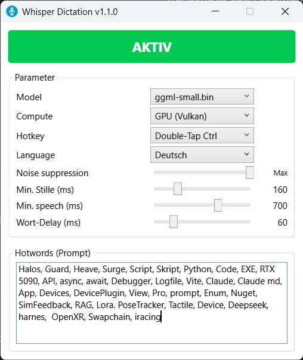

<p align="center">
  
</p>

<h1 align="center">WhisperDictation</h1>

<p align="center"><b>Local, GPU-accelerated speech-to-text dictation for Windows.</b></p>

<p align="center">
  A showcase by<br>
  <a href="https://www.rauschit.de"></a>
</p>

WhisperDictation is a Windows dictation tool. You speak, and the text appears in
whatever window currently has focus — a text editor, a browser, an e-mail client.
Speech recognition runs entirely on your own machine on your own graphics card.
No audio leaves the computer, and no account or internet connection is needed to
dictate.

> *"I dictate with it every day, and it is miles ahead of the dictation built into
> Windows. It also beats Apple's, even though Apple has improved noticeably
> recently. What makes the difference for me is mixed language: I speak German
> full of English technical terms — async, Debugger, Swapchain, NuGet — and they
> come out right, where the built-in dictation stumbles."*
>
> — Michael Rausch, Rausch IT

> **Status: experimental.** This is a working prototype, not a finished product.
> It is used daily by its author, but it has rough edges and known limits. Please
> read [Known limitations](#known-limitations) before you judge it.

---

## What it does

- Captures microphone audio at 16 kHz, mono, 16 bit via NAudio
- Detects speech segments with two-stage voice activity detection:
  WebRTC VAD decides in real time when a segment starts and ends, Silero VAD
  validates the finished segment and discards false positives
- Transcribes each segment with Whisper — `large-v3` for best quality or `small`
  for speed — on the GPU or on the CPU, both selectable in the window
- Runs on the GPU through **Vulkan**, so it is not tied to one vendor: NVIDIA, AMD
  and Intel graphics cards are supported alike, without CUDA or ROCm
- Types the recognized words into the focused window using `SendInput` with
  Unicode keyboard events, so it works with any application, not just a chat box
- Filters typical Whisper silence hallucinations ("Vielen Dank", "Untertitel von
  Stephanie Gündel", …) and asterisk stage directions
- Remembers its settings in `config.json` next to the executable
- Lives in the system tray: blue icon = idle, green icon = recording

## Who it is for

- People who want to dictate on Windows without sending their voice to a cloud service
- Anyone who needs speech-to-text on a machine that has a GPU but should not — or
  cannot — reach the internet with audio data
- Developers who want a readable example of a local Whisper pipeline in C#:
  audio capture, VAD, Whisper.net on Vulkan and text injection, in about
  2,500 lines of code

It is **not** meant to be deployed across a company. It is a single-user desktop
tool and a showcase.

## Requirements

| | |
|---|---|
| Operating system | Windows 10 or 11, 64-bit |
| Runtime | .NET Desktop Runtime 8 or newer (x64), e.g. [.NET 10](https://dotnet.microsoft.com/download/dotnet/10.0). The installer offers to install it if none is present |
| GPU | Any Vulkan-capable card — NVIDIA, AMD or Intel — for `large-v3`. `small` also runs acceptably on the CPU |
| Microphone | Any input device that Windows can open as the default recording device |
| Disk space | ~3.1 GB with `large-v3`, ~470 MB with `small`, ~3.6 GB with both; plus ~125 MB for the application |

Platform target is **x64**. There is no AnyCPU or x86 build.

## Installation

Download `WhisperDictation-<version>-setup.exe` from the
[Releases](https://github.com/RauschIT/WhisperDictation/releases) page and run it.

- **No administrator rights.** The application is installed for the current user
  only, into `%LOCALAPPDATA%\Programs\WhisperDictation`. Only if no .NET Desktop
  Runtime 8 or newer is present, setup offers to install .NET 10; that single step
  asks for administrator permission.
- **Models are downloaded during setup.** Choose `large-v3`, `small` or both. The
  Silero VAD model is always installed. The disk space needed for the selection is
  shown on the same page and checked before anything is downloaded. Every download
  is verified against its SHA-256 checksum. Models that are already present are
  not downloaded again, so an update is quick.
- **Options:** start with Windows (on by default) and a desktop icon (off by default).

Uninstall through *Settings → Apps*. This removes the application and the
downloaded models; `config.json` and the log file stay in the installation folder.

## Download the models

Only needed when you build from source; the installer downloads the models itself.

The model files are large and are **not** part of this repository. Download them
and place them in the `models` folder of the core project, so that the path looks
like this:

```
WhisperDictation.Core/
  models/
    ggml-large-v3.bin
    ggml-small.bin          (optional, only for the smaller model)
    silero_vad.onnx         (required)
    README.md               (already in the repository)
```

**Put them in the project folder, not in `bin`.** The build copies the whole
`models` folder into the output directory, so the application finds them after
building. If the folder holds no model files, the build still succeeds, but the
application starts with the message `Error: models not found.` and a dialog that
lists where it looked.

| File | Size | Purpose | Download |
|---|---|---|---|
| `ggml-large-v3.bin` | ~2.9 GB | Best quality, needs a GPU | [huggingface.co/ggerganov/whisper.cpp](https://huggingface.co/ggerganov/whisper.cpp/resolve/main/ggml-large-v3.bin) |
| `ggml-small.bin` | ~466 MB | Faster, lower quality, usable on CPU | [huggingface.co/ggerganov/whisper.cpp](https://huggingface.co/ggerganov/whisper.cpp/resolve/main/ggml-small.bin) |
| `silero_vad.onnx` | ~2.2 MB | Voice activity detection. **Required** | [huggingface.co/onnx-community/silero-vad](https://huggingface.co/onnx-community/silero-vad/resolve/main/onnx/model.onnx) |

More Whisper models in GGML format: <https://huggingface.co/ggerganov/whisper.cpp>

**About the formats.** GGML is the native tensor format of
[whisper.cpp](https://github.com/ggml-org/whisper.cpp), quantized and optimized
for CPU and GPU inference. Silero VAD is a small pretrained neural network that
distinguishes speech from silence and background noise; it is far more robust
than a simple energy threshold. It runs on the CPU through ONNX Runtime and takes
well under a millisecond per 32 ms audio chunk. It expects 512 samples at 16 kHz
as float32 mono and returns a probability between 0.0 and 1.0.

Only `silero_vad.onnx` has to be named exactly as listed. Every `ggml-*.bin` file
in the `models` folder appears in the model list of the window.

Model licences are listed in [THIRD-PARTY-NOTICES.md](THIRD-PARTY-NOTICES.md).

## Build

Requires the .NET 10 SDK (tested with 10.0.103). The application itself targets
.NET 8 and runs on any .NET Desktop Runtime from version 8 on.

```bash
git clone https://github.com/RauschIT/WhisperDictation.git
cd WhisperDictation
dotnet build WhisperDictation.App/WhisperDictation.App.csproj -c Release -r win-x64
```

Output: `WhisperDictation.App/bin/Release/net8.0-windows/win-x64/`

Build only the core library, without the WPF interface:

```bash
dotnet build WhisperDictation.Core/WhisperDictation.Core.csproj -c Release -r win-x64
```

### Build the installer

```powershell
.\installer\build-installer.ps1
```

The script publishes the application without the models and compiles the Inno
Setup script. Inno Setup is fetched automatically from NuGet; nothing has to be
installed. Output: `Releases/<version>/WhisperDictation-<version>-setup.exe`.
The version comes from the `VERSION` file in the repository root, the only place
it is stored.

### Known issue with the solution file

`WhisperDictation.slnx` currently does **not** build:

```
dotnet build WhisperDictation.slnx -c Release -r win-x64
→ Build FAILED.  0 Warning(s)  0 Error(s)
```

The failure happens during NuGet restore, inside the target
`_FilterRestoreGraphProjectInputItems`, and produces no error message at all.
It is reproducible with two empty projects in a solution, so it is not caused by
this code. A solution with a single project builds fine, and every individual
`.csproj` in this repository builds fine — which is why the build commands above
call the project files directly. Tested with .NET SDK 10.0.103, MSBuild 18.0.11.

## Usage

1. Install with the setup, or build from source and put the model files into
   `WhisperDictation.Core/models/` (see above).
2. Start WhisperDictation. The window stays hidden; the app appears as an icon in
   the system tray.
3. The status shows `Ready. CTRL+SPACE to dictate.` once the model is loaded.
   Loading `large-v3` takes about 2.5 seconds.
4. Click into the window where the text should go.
5. Press the hotkey to start recording, speak, press it again to stop. The
   transcript is typed into the focused window.

### Model and compute

The configuration window shows the status, all settings and the hotwords:



Model and compute are the two selections at the top:

| Setting | Choices |
|---|---|
| Model | Every `ggml-*.bin` in the `models` folder, e.g. `ggml-large-v3.bin` or `ggml-small.bin` |
| Compute | `GPU (Vulkan)` or `CPU` |

Switching loads the new model within a few seconds. The previous model keeps
working until then, also while you dictate. If loading fails, the previous model
stays active.

### Hotkeys

| Hotkey | Setting value | Behaviour |
|---|---|---|
| `Ctrl` + `Space` | `CtrlSpace` | Default. Registered system-wide via `RegisterHotKey` |
| Double-tap `Ctrl` | `CtrlDoubleTap` | Press `Ctrl` twice within 350 ms |

The hotkey is registered system-wide, so it works while any application is in
focus. `Ctrl`+`Space` is also used by some editors for autocomplete; if it
collides with your workflow, switch to double-tap `Ctrl`.

### Output into any window

Text is injected with `SendInput` using `KEYEVENTF_UNICODE` scan codes rather than
a clipboard paste. That means:

- the clipboard is untouched
- it works in windows that do not accept `Ctrl`+`V`
- it works with non-ASCII characters such as German umlauts

Words are queued in a thread-safe FIFO and typed with a configurable delay, so
the output does not appear as one instantaneous burst.

### Tray icon

| Colour | Meaning |
|---|---|
| Blue | Idle and ready |
| Green | Recording |

Double-click the icon, or choose **Configuration** in its menu, to show the
window. Closing the window hides it; the app keeps running in the tray. Use
**Quit** in the tray menu to exit.

## Configuration

Settings live in `config.json`, next to the executable. The window writes them on
every change; a missing file is created with defaults.

| Setting | Default | Meaning |
|---|---|---|
| `VadMode` | `3` | Noise suppression level, 0–3 (`Low`, `Mid`, `Hi`, `Max`) |
| `MinSilenceMs` | `160` | Silence needed to end a segment |
| `MinSpeechMs` | `700` | Minimum speech length for a segment to be accepted |
| `StartSpeechFrames` | `24` | Speech frames required before recording starts |
| `WordDelayMs` | `60` | Delay between typed words |
| `HotkeyMode` | `CtrlSpace` | `CtrlSpace` or `CtrlDoubleTap` |
| `Hotwords` | *(empty)* | Prompt text to bias recognition toward names and technical terms |
| `WhisperModel` | `ggml-large-v3.bin` | Model file in `models/`; selectable in the window. If it is missing, another model found in `models/` is used |
| `UseGpu` | `true` | `true` = GPU (Vulkan), `false` = CPU; selectable in the window |
| `Language` | `de` | Recognition language (`de`, `en`, …) |

`VadMode` maps onto the WebRTC VAD operating modes. Levels 0–2 use WebRTC modes
0–2 directly. Level 3 deliberately does **not** use WebRTC mode 3, because that
mode cuts off speech; it uses WebRTC mode 2 plus a stricter Silero check instead.

## Known limitations

These are real and reproducible. They are listed here rather than hidden.

1. **WebRTC VAD reacts to breathing.** Even in the most aggressive mode it
   classifies nasal breathing as speech. Its four modes (0–3) are not enough to
   separate breathing from quiet speech. The workaround is `MinSpeechMs = 700`,
   which discards short breath-triggered segments.

2. **`VadMode` only takes effect after the next toggle.** The WebRTC VAD object has
   no setter for its operating mode, only a constructor. Changing the slider
   updates the configuration, but the running detector keeps its mode until you
   stop and start recording again.

3. **Segments shorter than about 3 seconds give poor quality.** Whisper needs
   several seconds of audio for good results. Benchmarks on 1 s, 2 s, 3 s, 5 s,
   7 s and 10 s clips show a clear quality drop below 3 seconds. Very short
   utterances are often wrong or empty.

4. **Silero VAD was abandoned as the primary detector.** Its LSTM state falls into
   a dead state after prolonged use (probability stuck at 0.000). This was
   verified by comparing Python and C# on the same WAV file. Silero is now only
   used to validate finished segments, where a corrupted state is harmless
   because the state is reset before every call.

Additional rough edge: `Hotwords` work less reliably than in the Python prototype.

## How it works

```
WhisperDictation.App (WPF)
  └→ DictationManager
       ├→ SpeechSegmentDetector
       │    ├→ NAudioCapture (16 kHz / 16 bit / mono)
       │    ├→ WebRtcVadService       (real-time start/stop of a segment)
       │    └→ SileroVadOnnxModel     (validates the finished segment)
       ├→ WhisperService              (Vulkan GPU or CPU, switchable at runtime)
       ├→ WordOutputBuffer            (thread-safe FIFO)
       └→ TextOutputService           (SendInput, Unicode)
```

Configuration flows from the UI to `ConfigManager` and on to
`DictationManager.ApplyConfig()`; a model or compute change goes through
`DictationManager.ReloadWhisperAsync()`.

**Segments instead of streaming.** Text is typed after each pause in speech, one
segment at a time, not word by word while you speak. This is a deliberate choice:
streaming was implemented and tried, but did not prove practical in daily use.
`WordOutputBuffer` types the words of a segment one after another, so the output
still reads naturally.

`WhisperDictation.Core` is a plain library and console application (`net8.0`);
`WhisperDictation.App` is the WPF front end (`net8.0-windows`).

## Project layout

```
VERSION                         version number, the single source for all projects and the installer
WhisperDictation.slnx           solution file (see known issue above)
WhisperDictation.Core/          core library, net8.0
  Services/                     VAD, audio capture, Whisper, text output
  lib/WebRtcVadSharp/           local WebRTC VAD DLLs, not from NuGet
  models/                       model files go here (not in the repository)
WhisperDictation.App/           WPF application, net8.0-windows
  Assets/                       application and tray icons
installer/                      Inno Setup script and build script for the setup
docs/                           images for this README
```

## Built by Rausch IT

WhisperDictation is a showcase by [Rausch IT](https://www.rauschit.de). It shows
that capable AI models can run locally on ordinary consumer hardware and deliver
real value — without a cloud service, without special AI hardware, and without any
data leaving the machine:

- The full Whisper `large-v3` model transcribes speech on a regular graphics card,
  from NVIDIA, AMD or Intel alike, through Vulkan.
- The smaller model runs on the CPU alone, on machines without a suitable GPU.
- Audio never leaves the computer, which makes it usable where voice data must
  stay in-house.

If you want to bring local AI models into your own applications or workflows,
get in touch: [www.rauschit.de](https://www.rauschit.de).

## Licence

MIT — see [LICENSE](LICENSE). Copyright (c) 2026 Rausch IT.

This repository bundles third-party components and contains one source file
derived from third-party work. All of them are MIT or BSD-3-Clause licensed and
are listed with their full licence texts and copyright notices in
[THIRD-PARTY-NOTICES.md](THIRD-PARTY-NOTICES.md). The installer ships both files.

One consequence worth knowing: `WhisperDictation.Core/Services/SileroVadOnnxModel.cs` is
an adapted version of `VadOnnxModel.cs` from
[VadSharp](https://github.com/GabryB03/VadSharp) by Gabriele Bologna. It therefore
carries his MIT copyright, not ours.

## Contributing

This is a showcase project of Rausch IT, not a community project. Issues describing
reproducible problems are welcome. There is no roadmap and no support promise.
